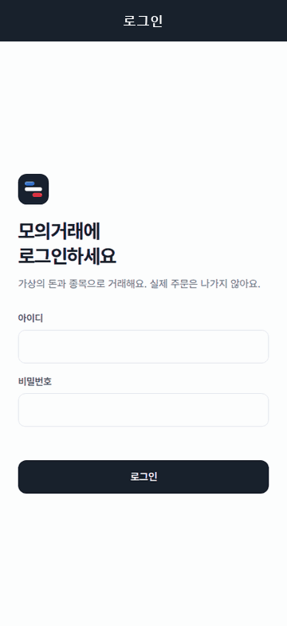
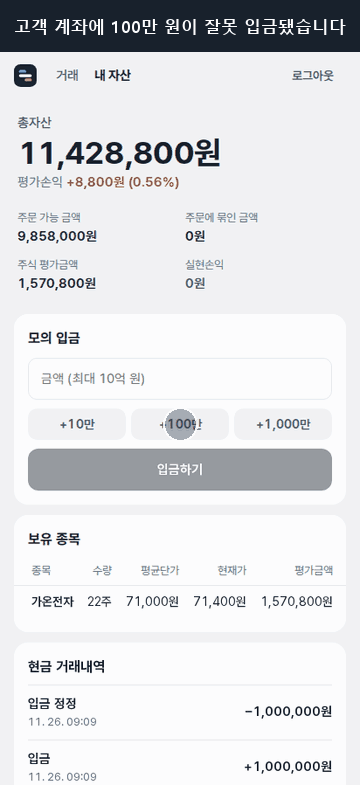
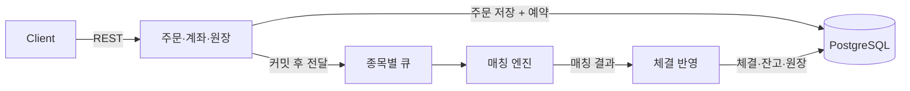
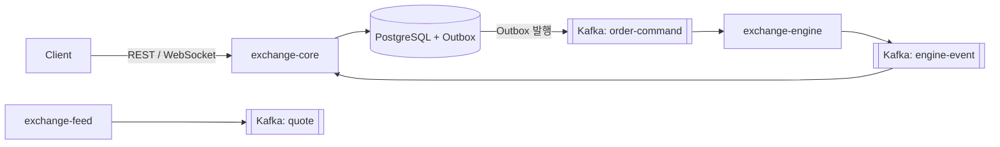

# 모의 증권 거래 시스템

주문을 받아 자체 매칭 엔진으로 체결하고, 복식부기 원장에 기록하는 미니 증권사 + 거래소입니다.
돈과 주식이 **유실되거나 중복되지 않게** 처리하고, 그것을 테스트와 대사로 **증명하는 것**이 목표입니다.

> **현재 상태: 1단계와 2단계의 엔진 분리(Kafka·Outbox), 모의 시세와 호가 봇, 실시간 화면을 마치고, 3단계의 감사 로그 해시 체인, 원장 정정 승인 분리, DB 계정 분리, 일 단위 대사와 운영자 화면까지 구현했습니다.** 성능 목표는 아직 달성하지 못했습니다([원인 측정](docs/experiments/2026-11-24-order-latency-cause.md)). 나머지는 설계이며 [진행 단계](#진행-단계)에 구현 현황을 표시합니다.

## 시연

<table>
<tr>
<td width="380"></td>
<td valign="top">

1. **실시간 호가**: 봇이 모의 시세를 따라 호가를 내고, 호가와 체결가 차트가 바로 바뀝니다.
2. **호가 선택**: 호가를 누르면 그 가격이 주문서에 들어갑니다.
3. **주문**: 수량을 비율로 고르고, 확인 창에서 주문 내용을 다시 봅니다.
4. **체결**: 세 번째 매도 호가로 주문해도 더 싼 호가부터 체결됩니다. 체결 내역과 보유 종목에 나타납니다.
5. **응답 유실**: 서버는 주문을 받았지만 응답이 끊긴 상황입니다. 화면은 실패라고 단정하지 않고 확인하지 못했다고 알립니다.
6. **재시도**: 같은 멱등키로 다시 보내 대기 주문이 **1건만** 생깁니다.
7. **취소**: 대기 주문을 취소하면 묶인 예약금이 풀립니다.
8. **원장**: 입금, 예약, 체결, 해제가 모두 거래내역에 남습니다.

</td>
</tr>
</table>

실제 백엔드, 매칭 엔진, Kafka, PostgreSQL에 연결해 녹화했습니다. 시세는 모의 시세 생성기가 만든 값입니다. 종목과 가격은 모두 가상입니다.

### 운영자 화면

<table>
<tr>
<td width="380"></td>
<td valign="top">

1. **잘못된 입금**: 고객 계좌에 100만 원이 잘못 들어왔습니다.
2. **정정 요청**: 운영자는 사유를 적어 요청만 할 수 있고, 승인 버튼이 없습니다.
3. **승인**: 다른 사람인 승인자가 사유와 요청자를 확인하고 승인합니다. 서버와 DB도 자기 승인을 막습니다.
4. **반대 전표**: 고객 거래내역에 원래 입금은 그대로 남고 '입금 정정'이 추가됩니다.
5. **감사 로그 검증**: 감사 담당자가 모든 감사 로그의 해시를 다시 계산해 기록 당시와 같은지 확인합니다.
6. **대사**: 잔고와 원장, 주문과 체결, 감사 로그가 맞는지 매일 자동으로 확인하고, 필요하면 지금 실행합니다. 결과는 지울 수 없는 이력으로 남습니다.

</td>
</tr>
</table>

## 화면

| 화면 | 내용 |
|---|---|
| 로그인 | 세션 쿠키 로그인, 실패 시 계정 존재 여부를 알 수 없는 같은 안내 |
| 거래 | 종목 목록, 체결가 차트, 10단계 호가, 지정가 주문, 대기·체결·보유·시세 탭 |
| 내 자산 | 총자산, 평가·실현손익, 모의 입금, 현금 원장 |
| 운영 | 역할별 화면. 대사 결과, 운영자는 입금 정정 요청, 승인자는 승인·거절, 감사 담당자는 감사 로그 검증 |

증권사 앱의 관례(상승 빨강, 하락 파랑)를 따르고, 빨강과 파랑은 매수·매도와 등락에만 씁니다. 모바일, 태블릿, 데스크톱과 라이트·다크 모드를 지원합니다.

## 풀려는 문제

| 문제 | 설계 |
|---|---|
| 한 계좌가 여러 종목을 동시에 주문하면 예수금이 초과 사용될 수 있다 | 조건부 UPDATE로 확인과 예약을 한 번에 처리하고, DB `CHECK` 제약으로 이중 방어 |
| 같은 종목의 주문 순서가 뒤바뀔 수 있다 | 종목별 단일 스레드로 처리해 호가창에 락을 쓰지 않고 가격·시간 우선을 보장 |
| 같은 주문이나 체결이 두 번 처리될 수 있다 | 주문은 계좌별 멱등키, 체결은 엔진이 부여한 종목별 순번으로 중복 제거 |
| 주문을 저장한 직후 서버가 죽을 수 있다 | 주문과 엔진에 보낼 명령을 한 트랜잭션으로 저장(Outbox)하고, 엔진은 명령 기록을 처음부터 다시 처리해 호가창을 복원 |
| 잔고가 틀려도 알아채지 못할 수 있다 | INSERT 전용 복식부기 원장을 기록하고, 잔고와 일치하는지 SQL로 대사 |
| 다른 사람의 계좌에 접근하거나 요청을 위조·재전송할 수 있다 | 소유자 검증, HMAC 서명, nonce, 감사 로그 해시 체인 |

## 아키텍처

### 1단계: 단일 애플리케이션 (구현했던 구조)



### 2단계: 엔진 분리 (현재 구조)



- 주문과 계좌는 나누지 않습니다. 주문 저장과 자금 예약이 한 트랜잭션이어야 하기 때문입니다.
- 매칭 엔진은 DB와 Spring에 의존하지 않습니다. 시계와 난수를 쓰지 않아 같은 입력에는 항상 같은 결과가 나옵니다.

## 주문 처리 흐름

```
주문 요청 (Idempotency-Key)
   │
   ├─ 인증, 계좌 소유자, 호가 단위, 상·하한가 검증
   │
   ├─ [트랜잭션] 예약 + 주문 저장 + 원장 기록 + 명령 저장(Outbox)  ──▶ ACCEPTED
   │
   ├─ Outbox 발행 ──▶ Kafka ──▶ 엔진이 가격·시간 우선 매칭 ──▶ Kafka
   │
   └─ [트랜잭션] 체결 + 주문 상태 + 잔고 + 원장 반영  ──▶ OPEN / PARTIALLY_FILLED / FILLED
          잠금 순서: 계좌(ID 순) → 보유 종목 → 주문
```

취소도 같은 명령 토픽을 거칩니다. 취소와 체결이 겹치면 엔진에 먼저 도착한 쪽이 처리됩니다.

## 항상 지켜야 하는 조건

통합 테스트와 대사 배치가 같은 SQL로 검증합니다.

1. 예약금과 예약 수량은 0 이상이며, 보유한 금액과 수량을 넘지 않는다.
2. 계좌별 현금 원장의 합은 예수금·예약금과 같다.
3. 계좌·종목별 주식 원장의 합은 보유 수량·예약 수량과 같다.
4. 한 거래에 속한 원장의 증감 합은 0이다.
5. 주문별 체결 수량의 합은 주문에 기록된 체결 수량과 같고, 주문 수량을 넘지 않는다.
6. 미체결 매수 주문의 예약금 합은 계좌의 예약금과 같다.
7. 미체결 매도 주문의 잔량 합은 종목의 예약 수량과 같다.

## 보안

| 위협 | 대응 |
|---|---|
| 계정 탈취 | Argon2id, 로그인 실패 잠금, 고위험 거래 TOTP |
| 요청 변조·재전송 | TLS, HMAC-SHA256 서명, 타임스탬프, nonce |
| 다른 사람의 계좌 접근 | 모든 계좌·주문 접근에서 소유자 검증 |
| 원장 조작 | 애플리케이션 DB 계정에 수정·삭제 권한 미부여, 정정은 반대 전표와 승인자 분리 (구현) |
| 거래 부인 | 감사 로그와 HMAC 해시 체인, 마지막 값을 DB 밖에 보관 (구현) |
| 개인정보 노출 | AES-256-GCM 암호화, 로그 마스킹, 가상 데이터만 사용 |
| 주문 폭주 | 계좌별 속도 제한, 큐 크기 제한 |

각 항목은 공격을 재현하는 테스트로 검증할 계획입니다.

## 검증 계획

| 구분 | 방법 |
|---|---|
| 정합성 | 무작위 주문 수만 건을 실행한 뒤 위 7개 조건 검사 |
| 동시성 | 같은 계좌 동시 주문, 같은 멱등키 동시 요청, 취소·체결 경합 |
| 장애 | 커밋 지점 전후로 프로세스를 강제 종료한 뒤 대사 |
| 성능 | k6로 주문 접수와 체결 지연 측정 (단일 종목 집중 / 다종목 분산) |
| 보안 | 타인 계좌 접근, 재전송, 서명 변조, 원장 직접 수정 시도 |

### 측정 결과

| 항목 | 결과 |
|---|---|
| 엔진 분리 후 강제 종료 9회 (core 4, 엔진 2, Kafka 2, DB 1) | 접수 응답한 3,342건 중 유실 **0건**, 불변식 위반 **0건**, 재기동 후 30초 안에 모두 처리(개선 후 기준) ([기록](docs/experiments/2026-11-25-kill-each-process.md)) |
| 엔진 분리 전 강제 종료 6회 | 접수 응답한 1,315건 중 유실 **0건**, 불변식 위반 **0건**, 재시작 후 20초 안에 밀린 주문·취소를 모두 처리 ([묶음 커밋 전](docs/experiments/2026-11-24-kill-under-load.md), [후](docs/experiments/2026-11-25-kill-under-load-batched.md)) |
| 동시성 테스트 | 같은 계좌 동시 주문 40건, 같은 멱등키 동시 요청 20건, 취소·체결 경합 30회에서 불변식 위반 0건 |
| 주문 접수 지연 (초당 40건, HDD) | 계좌 30개 분산 p99 484ms, 3개 집중 p99 1,502ms. **목표 100ms 미달** ([기록](docs/experiments/2026-11-24-order-latency-cause.md)) |
| 시세 중단 | 시세 프로세스를 죽이면 봇이 5.7초 안에 호가를 모두 거둠. 봇끼리 체결 0건, 불변식 위반 0건 |
| 감사 로그 변조, 자기 승인 | DB 관리자가 트리거를 끄고 고치거나 지워도 검증에서 탐지. 앱 계정의 원장 수정 시도는 모두 거부 ([기록](docs/experiments/2026-11-25-audit-tampering.md)) |
| 지연 원인 | 커밋마다 일어나는 디스크 동기화(1회 44ms). 진단용으로 동기화를 끄면 같은 부하에서 p99 13ms 이하 |
| 체결 개선 | 명령을 묶어 커밋해 접수~체결 p99 5,432 → 783ms, 밀린 주문 92 → 0건 (계좌 30개). 목표 300ms에는 미달 |

## 진행 단계

### 1단계: 정확한 단일 서버

- [x] 프로젝트 세팅, CI 보안 검사
- [x] 로그인, 계좌 소유자 검증
- [x] 모의 입금, 모의 주식 입고
- [x] 지정가 주문 접수, 예약, 멱등키
- [x] 매칭 엔진 (부분 체결, 취소, 자전거래 방지)
- [x] 체결 반영, 복식부기 원장
- [x] 재시작 시 호가창 복원
- [x] 대사 SQL
- [x] k6 부하 테스트 기준값 측정
- [x] 거래 화면 (로그인, 호가창·주문, 주문·체결 내역, 잔고·보유 종목)

### 2단계: 이벤트 기반 분리

- [x] Kafka, Outbox, 엔진 분리
- [x] 리플레이, 이벤트 중복·누락 처리
- [ ] 시장가, 정정, 수수료·거래세
- [x] 모의 시세, WebSocket, 호가 공급 봇
- [x] 실시간 호가·체결 화면

### 3단계: 보안·신뢰성

- [ ] HMAC 서명, 재전송 방지, TOTP
- [x] 감사 로그 해시 체인
- [x] 원장 정정 승인 분리, DB 계정 분리
- [x] 일 단위 대사 배치
- [ ] 개인정보 암호화와 키 교체
- [ ] 엔진 스냅샷, 모니터링, 부하 테스트 개선 비교
- [x] 운영자 화면: 대사 결과, 원장 정정 요청·승인, 감사 로그 검증

### 4단계: 이상거래 탐지

- [ ] 허수성 호가, 통정·가장매매, 비정상 로그인 탐지
- [ ] 정밀도·재현율 측정
- [ ] 이상거래 알림 화면

## 기술 스택

| 구분 | 기술 |
|---|---|
| Backend | Java 21, Spring Boot 4.1, Spring Security, Spring Data JPA |
| Frontend | React, Vite, TypeScript, TanStack Query |
| Database | PostgreSQL, Flyway |
| Messaging | Kafka |
| Test | JUnit 5, Testcontainers, k6, Playwright |
| Security | gitleaks, Semgrep, Trivy, OWASP ZAP (3단계) |
| Infra | Docker Compose, GitHub Actions, Prometheus·Grafana (3단계) |

## 저장소 구조

```
backend/
  matching/          매칭 엔진 라이브러리 (순수 Java)
  exchange-engine/   매칭 엔진 프로세스 (Kafka만 사용)
  exchange-feed/     모의 시세 프로세스
  exchange-core/     주문·계좌·원장 API 서버 (Spring Boot)
frontend/    React
docs/        설계 결정, 트러블슈팅, 실험 기록
compose.yml  로컬 개발용 PostgreSQL, Kafka
```

백엔드와 프론트엔드는 같은 저장소에서 폴더로 나누고, 같은 출처로 서비스합니다.

## 로컬 실행

### Docker로 한 번에 띄우기

Docker만 있으면 됩니다. `.env`의 값을 채우고 저장소 루트에서 실행합니다.

```bash
cp .env.example .env                  # CORE_PORT를 뺀 값을 모두 채운다
docker compose --profile app up --build
```

http://localhost:8080 에서 `demo`로 로그인합니다. 모의 시세와 호가 봇도 함께 켜집니다. 처음에는 이미지를 만드느라 몇 분 걸립니다. 8080을 다른 프로그램이 쓰면 `.env`의 `CORE_PORT`를 바꿉니다.

### 개발 환경에서 띄우기

실행하는 프로그램은 API 서버(core), 매칭 엔진, 화면 세 개입니다. 터미널을 나눠 순서대로 띄웁니다. JDK 21, Node.js 22.12 이상, Docker가 필요합니다.

```bash
cp .env.example .env                  # EXCHANGE_DEMO_PASSWORD, CORE_PORT를 뺀 값을 모두 채운다
cd backend
./gradlew :exchange-core:bootRun      # PostgreSQL(5433)과 Kafka(9094) 컨테이너를 함께 띄운다
./gradlew :exchange-engine:run        # 다른 터미널에서. core가 먼저 떠 있어야 한다
./gradlew build                       # 테스트 (Testcontainers)
```

호가가 움직이는 화면을 보려면 core를 `EXCHANGE_BOT_ENABLED=true`로 띄우고 `./gradlew :exchange-feed:run`을 함께 실행합니다. 8080을 다른 프로그램이 쓰면 core는 `SERVER_PORT`, 화면은 `BACKEND_URL` 환경변수로 바꿉니다.

DB와 Kafka 데이터는 짝이 맞아야 하므로 초기화할 때는 저장소 루트에서 `docker compose down -v`로 함께 지웁니다. 개발 환경에서는 감사 로그 체인의 마지막 값(`audit-anchor.log`)도 지웁니다. 남겨 두면 감사 로그 검증이 기록이 지워졌다고 알립니다.

`.env`에 `EXCHANGE_DEMO_PASSWORD`를 채우면 체험용 사용자(`demo`, 운영자 `operator`, 승인자 `approver`, 감사 담당자 `auditor`)와 호가가 만들어집니다. 다른 터미널에서 화면을 띄웁니다.

```bash
cd frontend
npm ci
npm run dev            # http://localhost:5173, /api는 백엔드로 프록시
npm run e2e            # Playwright 헤드리스 (EXCHANGE_DEMO_PASSWORD 환경변수 필요)
```

시연 GIF를 다시 만들 때는 `DEMO=1 npx playwright test demo --project=mobile` 후 `python3 e2e/make-demo-gif.py <한글 글꼴 경로>`와 `python3 e2e/make-demo-gif.py <한글 글꼴 경로> admin-demo`를 실행합니다(Pillow 필요).

`npm run build` 후 `./gradlew :exchange-core:bootJar`를 실행하면 화면이 jar에 포함되어 같은 출처로 서비스됩니다.

## 범위와 주의 사항

- 실제 증권사 계좌와 연결하지 않으며 실주문을 내지 않습니다. 모든 계좌, 예수금, 개인정보는 가상 데이터입니다.
- 신용·공매도·파생상품, T+2 결제, 동시호가, 장 운영 시간은 다루지 않습니다. 체결 즉시 결제하는 것으로 단순화합니다.
- 일부 거래 규칙은 실제 거래소와 다를 수 있습니다.

## 기록

설계 의사결정과 트러블슈팅은 docs/*에 연재합니다.