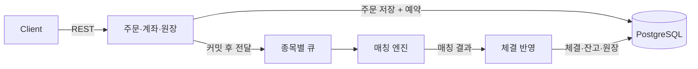
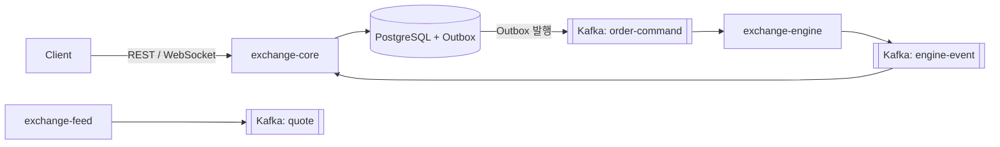

# 모의 증권 거래 시스템

주문을 받아 자체 매칭 엔진으로 체결하고, 복식부기 원장에 기록하는 미니 증권사 + 거래소입니다.
돈과 주식이 **유실되거나 중복되지 않게** 처리하고, 그것을 테스트와 대사로 **증명하는 것**이 목표입니다.

> **현재 상태: 설계를 마치고 1단계를 구현하고 있습니다.** 아래 내용은 설계이며, 구현 현황은 [진행 단계](#진행-단계)에 표시합니다.

## 풀려는 문제

| 문제 | 설계 |
|---|---|
| 한 계좌가 여러 종목을 동시에 주문하면 예수금이 초과 사용될 수 있다 | 조건부 UPDATE로 확인과 예약을 한 번에 처리하고, DB `CHECK` 제약으로 이중 방어 |
| 같은 종목의 주문 순서가 뒤바뀔 수 있다 | 종목별 단일 스레드로 처리해 호가창에 락을 쓰지 않고 가격·시간 우선을 보장 |
| 같은 주문이나 체결이 두 번 처리될 수 있다 | 주문은 계좌별 멱등키, 체결은 엔진이 부여한 종목별 순번으로 중복 제거 |
| 주문을 저장한 직후 서버가 죽을 수 있다 | 커밋 후 엔진에 전달하고, 재시작하면 DB에서 호가창을 복원하고 미전달 주문을 다시 전달 |
| 잔고가 틀려도 알아채지 못할 수 있다 | INSERT 전용 복식부기 원장을 기록하고, 잔고와 일치하는지 SQL로 대사 |
| 다른 사람의 계좌에 접근하거나 요청을 위조·재전송할 수 있다 | 소유자 검증, HMAC 서명, nonce, 감사 로그 해시 체인 |

## 아키텍처

### 1단계: 단일 애플리케이션



### 2단계: 엔진 분리



- 주문과 계좌는 나누지 않습니다. 주문 저장과 자금 예약이 한 트랜잭션이어야 하기 때문입니다.
- 매칭 엔진은 DB와 Spring에 의존하지 않습니다. 시계와 난수를 쓰지 않아 같은 입력에는 항상 같은 결과가 나옵니다.

## 주문 처리 흐름

```
주문 요청 (Idempotency-Key)
   │
   ├─ 인증, 계좌 소유자, 호가 단위, 상·하한가 검증
   │
   ├─ [트랜잭션] 예약 + 주문 저장 + 원장 기록  ──▶ ACCEPTED
   │
   ├─ 커밋 후 엔진 전달 ──▶ 가격·시간 우선 매칭  ──▶ OPEN / PARTIALLY_FILLED / FILLED
   │
   └─ [트랜잭션] 체결 + 주문 상태 + 잔고 + 원장 반영
          잠금 순서: 계좌(ID 순) → 보유 종목 → 주문
```

취소도 같은 엔진 큐를 거칩니다. 취소와 체결이 겹치면 엔진에 먼저 도착한 쪽이 처리됩니다.

## 항상 지켜야 하는 조건

통합 테스트와 대사 배치가 같은 SQL로 검증합니다.

1. 예약금과 예약 수량은 0 이상이며, 보유한 금액과 수량을 넘지 않는다.
2. 계좌별 현금 원장의 합은 예수금·예약금과 같다.
3. 계좌·종목별 주식 원장의 합은 보유 수량·예약 수량과 같다.
4. 한 거래에 속한 원장의 증감 합은 0이다.
5. 주문별 체결 수량의 합은 주문에 기록된 체결 수량과 같고, 주문 수량을 넘지 않는다.
6. 미체결 매수 주문의 예약금 합은 계좌의 예약금과 같다.
7. 미체결 매도 주문의 잔량 합은 종목의 예약 수량과 같다.

## 보안

| 위협 | 대응 |
|---|---|
| 계정 탈취 | Argon2id, 로그인 실패 잠금, 고위험 거래 TOTP |
| 요청 변조·재전송 | TLS, HMAC-SHA256 서명, 타임스탬프, nonce |
| 다른 사람의 계좌 접근 | 모든 계좌·주문 접근에서 소유자 검증 |
| 원장 조작 | 애플리케이션 DB 계정에 수정·삭제 권한 미부여, 정정은 반대 전표와 승인자 분리 |
| 거래 부인 | 감사 로그와 해시 체인 |
| 개인정보 노출 | AES-256-GCM 암호화, 로그 마스킹, 가상 데이터만 사용 |
| 주문 폭주 | 계좌별 속도 제한, 큐 크기 제한 |

각 항목은 공격을 재현하는 테스트로 검증할 계획입니다.

## 검증 계획

| 구분 | 방법 |
|---|---|
| 정합성 | 무작위 주문 수만 건을 실행한 뒤 위 7개 조건 검사 |
| 동시성 | 같은 계좌 동시 주문, 같은 멱등키 동시 요청, 취소·체결 경합 |
| 장애 | 커밋 지점 전후로 프로세스를 강제 종료한 뒤 대사 |
| 성능 | k6로 주문 접수와 체결 지연 측정 (단일 종목 집중 / 다종목 분산) |
| 보안 | 타인 계좌 접근, 재전송, 서명 변조, 원장 직접 수정 시도 |

측정 결과는 구현하면서 추가합니다.

## 진행 단계

### 1단계: 정확한 단일 서버

- [x] 프로젝트 세팅, CI 보안 검사
- [ ] 로그인, 계좌 소유자 검증
- [ ] 모의 입금, 모의 주식 입고
- [ ] 지정가 주문 접수, 예약, 멱등키
- [ ] 매칭 엔진 (부분 체결, 취소, 자전거래 방지)
- [ ] 체결 반영, 복식부기 원장
- [ ] 재시작 시 호가창 복원
- [ ] 대사 SQL, 부하 테스트 기준값 측정
- [ ] 거래 화면 (로그인, 호가창·주문, 주문·체결 내역, 잔고·보유 종목)

### 2단계: 이벤트 기반 분리

- [ ] Kafka, Outbox, 엔진 분리
- [ ] 리플레이, 이벤트 중복·누락 처리
- [ ] 시장가, 정정, 수수료·거래세
- [ ] 시세 수집, WebSocket, 호가 공급 봇
- [ ] 실시간 호가·체결 화면

### 3단계: 보안·신뢰성

- [ ] HMAC 서명, 재전송 방지, TOTP
- [ ] 감사 로그 해시 체인, 개인정보 암호화와 키 교체
- [ ] 원장 정정 승인 분리, 일 단위 대사 배치
- [ ] 엔진 스냅샷, 모니터링, 부하 테스트 개선 비교
- [ ] 운영자 화면 (대사 결과, 감사 로그 검증, 원장 정정 승인)

### 4단계: 이상거래 탐지

- [ ] 허수성 호가, 통정·가장매매, 비정상 로그인 탐지
- [ ] 정밀도·재현율 측정
- [ ] 이상거래 알림 화면

## 기술 스택

| 구분 | 기술 |
|---|---|
| Backend | Java 21, Spring Boot 4.1, Spring Security, Spring Data JPA |
| Frontend | React, Vite, TypeScript, TanStack Query (1단계 후반) |
| Database | PostgreSQL, Flyway |
| Messaging | Kafka (2단계) |
| Test | JUnit 5, Testcontainers, k6, Playwright |
| Security | gitleaks, Semgrep, Trivy, OWASP ZAP (3단계) |
| Infra | Docker Compose, GitHub Actions, Prometheus·Grafana (3단계) |

## 저장소 구조

```
backend/     Spring Boot
frontend/    React (1단계 후반에 추가)
docs/        설계 결정, 트러블슈팅, 실험 기록
compose.yml  로컬 개발용 PostgreSQL
```

백엔드와 프론트엔드는 같은 저장소에서 폴더로 나누고, 같은 출처로 서비스합니다.

## 로컬 실행

JDK 21과 Docker가 필요합니다.

```bash
cp .env.example .env   # POSTGRES_PASSWORD 값을 채운다
cd backend
./gradlew bootRun      # PostgreSQL 컨테이너를 함께 띄운다 (localhost:5433)
./gradlew build        # 테스트 (Testcontainers)
```

## 범위와 주의 사항

- 실제 증권사 계좌와 연결하지 않으며 실주문을 내지 않습니다. 모든 계좌, 예수금, 개인정보는 가상 데이터입니다.
- 신용·공매도·파생상품, T+2 결제, 동시호가, 장 운영 시간은 다루지 않습니다. 체결 즉시 결제하는 것으로 단순화합니다.
- 일부 거래 규칙은 실제 거래소와 다를 수 있습니다.

## 기록

설계 의사결정과 트러블슈팅은 docs/*에 연재합니다.